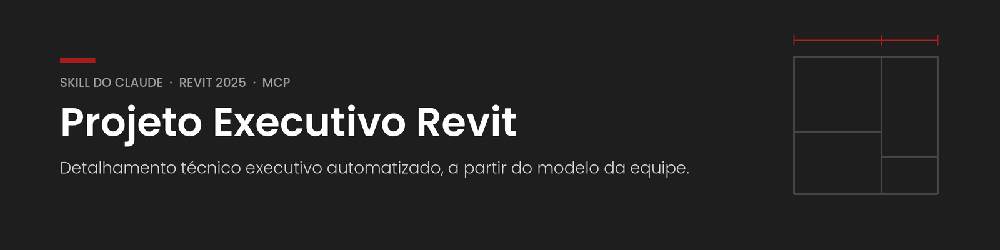
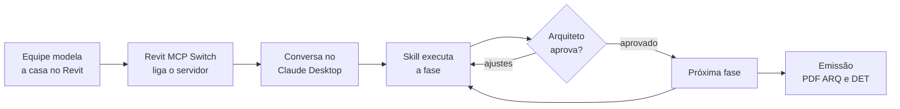

<p align="center">
  
</p>

<p align="center">
  
  
  
  
  
</p>

<p align="center">
  <b>Skill do Claude que faz o detalhamento técnico executivo de projetos de arquitetura no Revit</b><br>
  vistas · cotas · textos · identificadores · tabelas · carimbo · pranchas ARQ e DET · emissão
</p>

<p align="center">
  <a href="#-o-que-a-skill-faz">O que faz</a> ·
  <a href="#-como-funciona">Como funciona</a> ·
  <a href="#-fases">Fases</a> ·
  <a href="#-instalação">Instalação</a> ·
  <a href="#-estrutura-do-repositório">Estrutura</a> ·
  <a href="#-scripts">Scripts</a> ·
  <a href="CHANGELOG.md">Changelog</a>
</p>

---

> [!IMPORTANT]
> **A equipe modela, a skill faz o executivo.** Paredes, esquadrias, pisos, forros, cobertura, ambientes e o layout são
> modelados pela equipe. A partir do modelo pronto, a skill faz o projeto executivo inteiro:
> - anotações, cotas, implantação, plantas complementares, carimbo, pranchas e emissão;
> - elementos externos (abrigo, captação, lixeira…) **propostos** para aprovação;
> - regras de projeto fora do padrão **corrigidas** com aprovação.

## ✦ O que a skill faz

| A skill faz | Continua com a equipe |
|---|---|
| Conferência do modelo e correção das regras de projeto aprovadas (peitoril, portas, bancadas) | Toda a modelagem, inclusive o layout |
| Plantas, cortes, fachadas, perspectivas e plantas complementares (ar, hidro e gás, iluminação externa) | Decisões de projeto que a conferência apontar |
| Identificadores, cotas em três escalas, textos, paginação e eixos hidrossanitários | Escada (não é detalhada pela skill) |
| Implantação: rua, lotes vizinhos, numeração, norte e recuos em azul tracejado | Cotas L/H das esquadrias e cadernos de pedras/pintura (próxima etapa) |
| Elementos externos propostos para aprovação (abrigo, captação, lixeira, piso tátil, rebaixo, gás, ducha) | Aprovação de cada fase |
| Tabelas, áreas, índices, carimbo com QR code, pranchas ARQ (A1) e DET (A3), conferência e emissão | |

Genérica: serve a qualquer escritório. Os dados do escritório ficam no perfil (`skill/config/escritorio.json`), nunca no código.

## ✦ Como funciona



1. Cada escritório mantém uma **pasta-base** no servidor com o template master, o projeto de referência e as configurações.
2. Em cada computador, o **instalador** prepara tudo: arquivos da skill, MCP do Revit, guia e atalhos.
3. A skill é enviada ao Claude uma vez por conta (**Personalizar › Skills**).
4. Com o Revit aberto e o servidor do MCP ligado, a skill conduz o detalhamento fase a fase e **para em cada ponto de aprovação**.

## ✦ Fases

| # | Fase | O que acontece |
|:-:|---|---|
| 0 | Pré-voo | Confere Revit, MCP, arquivos abertos, rede e template (só leitura) |
| 1 | Recebimento | Registra o projeto modelado, dados do carimbo e pavimentos |
| 2 | Planta de layout | Anota o layout da equipe e monta a folha de proposta |
| 3 | Conferência do modelo | Relatório BLOQUEIA / CORRIGIR / ATENÇÃO e regras de projeto; corrige o que for aprovado |
| 4 | Ambientes | Ambiente de cada porta e janela, para as tabelas |
| 5 | Vistas e folhas | Plantas por pavimento, cortes, fachadas, perspectivas e pranchas ARQ |
| 6 | Anotação | Identificadores, níveis, cotas, textos, implantação, recuos e elementos externos (proposta) |
| 7 | Tabelas | Esquadrias e luminotécnica a partir do modelo |
| 8 | Carimbo e áreas | Regiões de área, taxas, índices, campos do carimbo e QR code |
| 9 | Detalhamento (DET) | Montagens de esquadrias e bancadas em folhas A3 |
| 10 | Conferência final | Numeração i/N, folhas vazias, carimbo, tabelas, área útil |
| 11 | Emissão | PDF por caderno (opcional: por folha e DWG) e registro |

<details>
<summary><b>Padrões de cotas e textos</b></summary>
<br>

| Prancha | Regra |
|---|---|
| Planta executiva | Nenhuma cota dentro do lote. Nas 4 faces, por fora dos muros, 3 escalas: micro (vãos de portas e janelas), médio (ambiente por ambiente) e macro (total do terreno) |
| Layout | Medidas dos ambientes só em texto, no canto de cada ambiente |
| Tomadas | Ao longo da parede: parede › ponto › ponto › parede |
| Iluminação | Por ambiente e por fileira; perfis e trilhos pelas pontas |
| Cobertura | Corpo e beiral separados, mais o total |
| Cortes | Só na vertical: piso › forro › laje em cada ambiente; à esquerda, piso de cada pavimento e altura total |
| Ar-condicionado · hidro e gás · iluminação externa | BTU/h e modelo de cada equipamento, distância evaporadora–condensadora; chamadas com altura em torneiras, água quente/fria e gás; altura das luminárias de parede |

Textos (chamadas de materiais, REVEST., PISO, tomadas fora da altura padrão, bancadas) vêm do modelo. O que não estiver no
modelo vira aviso no relatório; a skill nunca inventa texto.
</details>

<details>
<summary><b>Checklist executivo do escritório</b></summary>
<br>

Cada item do checklist executivo está ligado à skill em [`skill/references/checklist-executivo.md`](skill/references/checklist-executivo.md):
o que ela **faz**, o que ela **confere** (aponta nos relatórios da conferência do modelo e da conferência final) e o que fica
com a **equipe**. A conferência do modelo mede no modelo as regras de projeto do checklist (peitoril, portas, vaga,
bancadas) e a conferência final procura os itens das pranchas (carimbo, implantação, elementos, legendas, tabelas).
</details>

<details>
<summary><b>Casas de mais de um pavimento</b></summary>
<br>

- Plantas por pavimento: executivo, layout, tomadas, iluminação, forro e paginação.
- Cotas externas em todos os pavimentos pela mesma regra do lote (divisas vindas do térreo).
- Cortes com cadeia por ambiente até a laje de cima e linha de pé-direito por pavimento.
- Pranchas: um pavimento por folha; dois na mesma folha quando couber (modo `"testar"`), numeração i/N pela quantidade final.
- Áreas construídas por pavimento e total.

Detalhes em [`skill/references/gabarito-folhas.md`](skill/references/gabarito-folhas.md).
</details>

## ✦ Instalação

### Para a equipe (uma vez por computador)

| | Passo |
|:-:|---|
| **1** | Rode **`InstaladorSkillExecutivoRevit.exe`**: uma janela em cinco telas, com a skill embutida |
| **2** | Informe a **pasta-base** e, na primeira vez, o perfil do escritório. Se faltar, marque **Instalar o MCP do Revit** |
| **3** | No fim, a pasta com o ZIP abre com ele selecionado e a tela mostra os passos manuais |
| **4** | No Claude: **Configurações › Capacidades** › ative a execução de código |
| **5** | **Personalizar › Skills › + › Criar skill › Enviar uma skill** e envie o ZIP |
| **6** | Reinicie o Claude Desktop e, no Revit, clique em **Suplementos › Revit MCP Switch** |

O passo a passo ilustrado está no [**guia de uso em PDF**](docs/Guia_Skill_Executivo_Revit.pdf).

> [!TIP]
> O suplemento aparece no Revit, mas o conector **revit-mcp** não aparece no Claude Desktop? Feche o Claude Desktop por
> completo e rode `installer/CONFIGURAR_MCP_CLAUDE.cmd`: ele grava o servidor em todas as pastas de configuração do
> Claude Desktop (inclusive a da versão da Microsoft Store), em UTF-8 sem BOM.

### Para o responsável (gerar o instalador)

```bat
:: em uma máquina Windows com internet, dentro de installer\
:: opcional: repo.txt com "usuario/repositorio" para o .exe avisar de versões novas
COMPILAR_EXE.cmd
```

`montar-pacote.ps1` embute a skill, o guia e as fontes no script e o `ps2exe` gera o `InstaladorSkillExecutivoRevit.exe`.
O `.exe` funciona sem internet para a skill; usa a internet só para instalar o MCP e verificar versões.

**Release no GitHub:** ao publicar uma release, a ação `.github/workflows/instalador.yml` gera o `.exe` com o código daquela
versão e anexa na release. Também dá para rodar à mão em **Actions › Instalador (.exe) › Run workflow**. Distribua sempre
o `.exe` da última release (ou um recompilado na pasta-base): um `.exe` antigo leva os defeitos da versão em que foi gerado.

<details>
<summary><b>Opções do instalador</b></summary>
<br>

| Opção | Efeito |
|---|---|
| `-PastaBase X:\...` | Pasta-base já preenchida |
| `-Repo usuario/repositorio` | Repositório para avisos de versão |
| `-RevitAno 2025` | Versão do Revit para o MCP |
| `-McpRepo usuario/repositorio` · `-McpTag v1.2.0` | Origem e versão do MCP (padrão `LuDattilo/revit-mcp-server`) |
| `-AtualizarMcp` · `-SemMcp` | Reinstala o MCP · pula a etapa do MCP |
| `-Previa <pasta>` | Salva imagens das telas e sai (para revisar o visual) |
</details>

### Requisitos

- **Autodesk Revit 2025** (o template master é 2025)
- **MCP do Revit** (`mcp-servers-for-revit`), instalado pelo instalador se faltar
- **Claude Desktop** com execução de código ativada e a pasta-base conectada na conversa
- **Pasta-base** acessível pelo mesmo caminho em todos os computadores

## ✦ Estrutura do repositório

```
├── skill/                      o que vira o ZIP enviado ao Claude
│   ├── SKILL.md                instruções principais: escopo, regras e fases
│   ├── config/escritorio.json  perfil do escritório
│   ├── references/             fases, gabaritos das folhas, parâmetros, questionário
│   └── scripts/                rotinas C# executadas pelo MCP (send_code_to_revit)
├── installer/                  instalador em janela e gerador do .exe
├── pasta-base-modelo/          estrutura e configurações da pasta-base
├── docs/                       guia de uso (PDF), especificação e imagens
└── CHANGELOG.md
```

## ✦ Scripts

<details>
<summary><b>Fases 0 a 4 — preparação e conferência</b></summary>
<br>

| Script | Função |
|---|---|
| `00_preflight.cs` | Confere conexão, arquivos abertos, rede, configuração e template (só leitura) |
| `00_limpar_template.cs` | Relatório e limpeza das sobras do exemplo no template master (só numa cópia) |
| `01_preparar_template_local.cs` | Copia o template master para o disco local, só se estiver desatualizado |
| `01_criar_projeto.cs` | Cria um arquivo a partir da cópia local (só se a equipe pedir) |
| `01_preencher_dados.cs` | Grava as Informações do projeto (carimbo) e as cotas dos níveis |
| `01_ajustar_pavimentos.cs` | Uma folha de proposta de layout por pavimento |
| `02_proposta.cs` | Folhas da proposta de layout, uma por pavimento, com a implantação na primeira |
| `02_desenhar_lote.cs` | Lote, projeção, cotas e recorte nas implantações sem linhas de propriedade |
| `03_conferir_modelo.cs` | Conferência do modelo: BLOQUEIA / CORRIGIR / ATENÇÃO (só leitura) |
| `03_corrigir_modelo.cs` | Correções aprovadas: sobras do modelo e regras de projeto (peitoril, portas, bancadas) |
| `04_ambientes.cs` | Campo AMBIENTE das portas e janelas |
</details>

<details>
<summary><b>Fase 5 — vistas e folhas ARQ</b></summary>
<br>

| Script | Função |
|---|---|
| `05_plantas.cs` | Plantas do caderno por pavimento, cobertura e implantação; avisa as vazias |
| `05_situacao.cs` · `05_situacao_importar.cs` | Planta de situação vetorial ou a partir da imagem do loteamento |
| `05_propor_cortes.cs` | Propõe 4 cortes (2 transversais, 2 longitudinais) para aprovação |
| `05_criar_fachadas.cs` | 4 fachadas com a frente detectada pela calçada |
| `05_vistas_ambientes.cs` | Vistas de iluminação e conjuntos de paginação por ambiente |
| `05_perspectivas.cs` | Perspectivas dos cortes e das laterais |
| `05_montar_folhas.cs` | Folhas de cortes e de fachadas |
| `05_montar_folhas_gerais.cs` | Folhas de planta executiva, cobertura e situação, iluminação e tomadas (com modo `"testar"`) |
| `05_montar_folhas_ambientes.cs` | Folhas de forro e iluminação e de paginação, por pavimento |
</details>

<details>
<summary><b>Fases 6 a 11 — anotação, carimbo, DET e emissão</b></summary>
<br>

| Script | Função |
|---|---|
| `06_anotar_planta.cs` | Identificadores, cotas de nível e cotas externas (3 linhas por face) |
| `06_cotar_pranchas.cs` | Cotas por prancha: layout, tomadas, eixos hidrossanitários, iluminação, cobertura e cortes |
| `06_textos.cs` | Chamadas de materiais, revestimentos, forro, tomadas, paginação, ar-condicionado, hidro e gás, bancadas |
| `06_implantacao.cs` | Rua, largura, pavimentação, lotes vizinhos, numeração, norte e linhas de recuo |
| `06_elementos_externos.cs` | Proposta de abrigo, gás, captação, lixeira, rebaixo, ducha e piso tátil; aprovar ou desfazer |
| `08_qrcode.cs` | QR code no carimbo de todas as folhas |
| `08_regioes_areas.cs` | Regiões de área construída, permeável e piscina a partir dos pisos |
| `calcular_areas_indices.cs` | Áreas, taxas e índices a partir das regiões da implantação |
| `09_montagens.cs` | Montagens de esquadrias, bancadas e especiais, com elevação, topo e 3D |
| `09_montar_folhas_det.cs` | Folhas A3 do caderno DET a partir das montagens |
| `10_conferencia_final.cs` | Numeração, folhas vazias, carimbo, tabelas e área útil |
| `11_emitir.cs` | PDF por caderno (opcional: por folha e DWG) e registro EMISSAO.txt |
</details>

## ✦ Segurança

- Nunca trabalha no **template master** nem em projeto de outra pessoa.
- Não abre, cria nem salva arquivos Revit grandes **pela rede**.
- **Nada é salvo sem confirmação.** Toda alteração fica numa transação "Skill: …", desfazível com Ctrl+Z.
- **Não modela:** problemas do modelo vão para o relatório, e a equipe corrige.
- Avisos do Revit são tratados dentro das rotinas, para não abrir janelas que travam a conversa.

## ✦ Configuração

| Arquivo | Conteúdo |
|---|---|
| `skill/config/escritorio.json` | Nome, prefixo, responsáveis, carimbos e caminhos do escritório |
| `pasta-base-modelo/_config/PARAMETROS_COMPARTILHADOS_SKILL.txt` | 22 parâmetros compartilhados com GUIDs fixos (lista em `skill/references/parametros.md`) |
| `docs/ESPECIFICACAO.md` | Especificação completa da skill |

---

<p align="center">
  <sub>Versões e novidades no <a href="CHANGELOG.md">CHANGELOG</a> · Guia para a equipe em <a href="docs/Guia_Skill_Executivo_Revit.pdf">docs/Guia_Skill_Executivo_Revit.pdf</a></sub>
</p>
